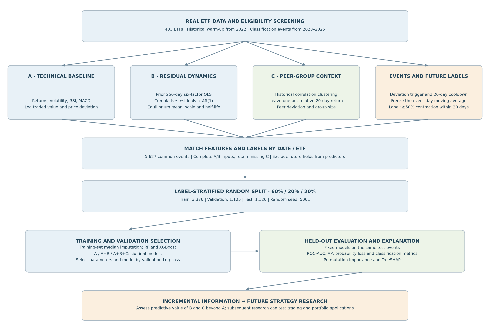
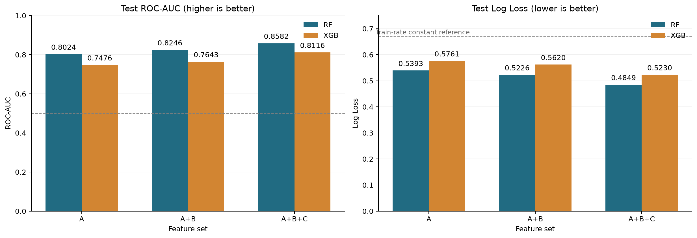
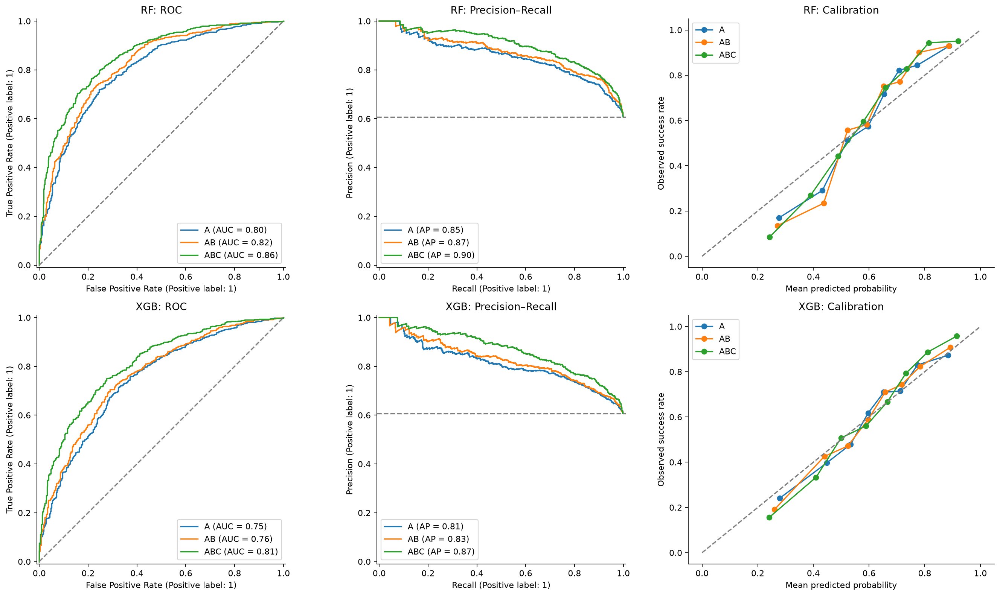
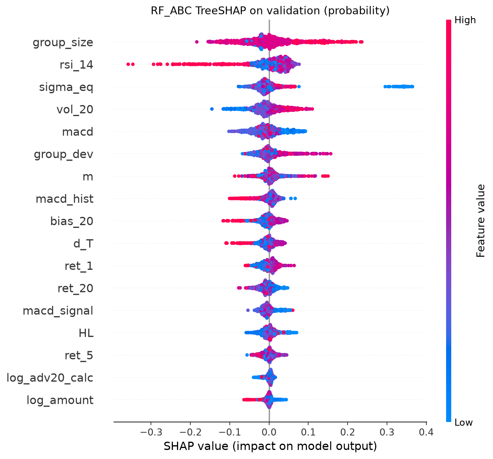

# Incremental Prediction of ETF Price Mean Reversion

Do factor-residual dynamics and peer-group information improve the prediction of ETF price mean reversion beyond conventional technical indicators?

This project tests that question using real ETF data, Random Forest, and XGBoost. It evaluates the predictive value of the indicators as a foundation for future strategy construction and portfolio research.

## Research Background and Motivation

An ETF's recent price movement reflects both shared market conditions and asset-specific behavior. Technical indicators describe its own returns, momentum, volatility, and price deviation, but may leave useful information unexplained.

Two additional perspectives motivate this study:

- **Factor-Residual Dynamics:** after controlling for common market exposures, the residual process may reveal differences in equilibrium level, variability, and persistence.
- **Peer-Group Deviation:** an ETF's recent performance relative to similar ETFs may distinguish a shared market move from an unusual individual deviation. Group size provides additional context for that comparison.

The experiment compares **A**, **A+B**, and **A+B+C** within each algorithm to assess the incremental information in these feature groups.

## Research Workflow



*Features use information available by the event date. Future prices generate labels only; complete event rows are subsequently split at random.*

The data panel contains **483 ETFs**. Historical observations from 2022 provide the rolling warm-up; classification uses events from **2023–2025**, with no 2026 observations. Features are calculated in their original chronological order before complete event rows are shuffled for model training.

After removing one event with incomplete A/B inputs, the common sample contains **5,627 events across 329 ETFs**. The actual event dates range from February 2, 2023 to December 3, 2025. All six model configurations use the same label-stratified **60% / 20% / 20%** random split: 3,376 training, 1,125 validation, and 1,126 test events, with random seed 5001.

## Technical Methods

### Features

| Group | Inputs | Purpose |
|---|---|---|
| **A: Technical baseline** | 12 features: 1/5/20-day log returns, 20-day volatility, RSI, MACD and its signal/histogram, log-transformed daily/average traded value, moving-average bias, and initial price deviation | Control for recent price behavior, activity, and the starting deviation |
| **B: Factor-Residual Dynamics** | Residual equilibrium mean `m`, equilibrium standard deviation `sigma_eq`, and half-life `HL` | Summarize the level, scale, and decay speed of residual dynamics |
| **C: Peer-group information** | Leave-one-out peer-relative 20-day return `group_dev` and group size `group_size` | Add contemporaneous information about comparable ETFs |

B is constructed by regressing each ETF's returns on six ETF factor proxies over the preceding **250 trading days**, accumulating the window's residuals, and fitting an **AR(1)** process. AR(1) provides a simple, interpretable description of persistence; equilibrium summaries are calculated for valid, nondegenerate estimates with an autoregressive coefficient between zero and one.

C uses hierarchical clustering of historical return correlations, updated every **60 trading days**. Peer deviation compares the ETF's past 20-day log return with the mean return of the other ETFs in its group. Group membership is based on historical observations, and peer averages use the daily panel rather than only ETFs triggering an event.

### Labels and Preprocessing

An event is triggered when the absolute log-price deviation from its 20-day moving average reaches **1.25 times** its rolling deviation standard deviation. A 20-trading-day cooldown separates accepted events for each ETF.

The event-day moving average is then frozen. The label is **1** if the absolute deviation contracts by at least **50%** at an eligible observation within the next **20 trading days**, and **0** otherwise. Incomplete label windows and windows crossing the original source-period boundary are excluded. Future observations construct the label only.

Daily and average traded values use `log1p`. Events with nonfinite A/B inputs are excluded consistently across models. The 532 events with missing C features are retained; each pipeline fills those values using medians fitted on the training subset. Validation and test data do not determine the imputation values.

### Models and Evaluation

Random Forest and XGBoost each use A, A+B, and A+B+C, giving **six final models**. Parameters are selected by validation Log Loss, with ROC-AUC as the tie-breaker. The classification threshold is fixed at 0.5. Test data are evaluated after selection.

ROC-AUC and Average Precision measure ranking performance; Log Loss and Brier score assess probability quality. Accuracy, Precision, Recall, and F1 describe classification at the fixed threshold. Permutation importance and TreeSHAP explain the fitted models. Evaluation uses the held-out samples without bootstrap resampling.

## Experimental Results

Current held-out test results (**1,126 events**, positive rate **60.75%**):

| Model | Features | ROC-AUC ↑ | Average Precision ↑ | Log Loss ↓ | Accuracy ↑ | F1 ↑ |
|---|---|---:|---:|---:|---:|---:|
| RF | A | 0.8024 | 0.8544 | 0.5393 | 74.42% | 0.8077 |
| RF | A+B | 0.8246 | 0.8703 | 0.5226 | 77.09% | 0.8275 |
| RF | A+B+C | 0.8582 | 0.8990 | 0.4849 | 78.33% | 0.8306 |
| XGB | A | 0.7476 | 0.8127 | 0.5761 | 70.16% | 0.7787 |
| XGB | A+B | 0.7643 | 0.8267 | 0.5620 | 70.78% | 0.7811 |
| XGB | A+B+C | 0.8116 | 0.8668 | 0.5230 | 74.78% | 0.8039 |



*Adding B and then C improves ranking and probability loss for both algorithms on the same held-out events.*

Both algorithms improve in ROC-AUC, Average Precision, and Log Loss as features progress from A to A+B to A+B+C. Relative to A, the full feature set increases test ROC-AUC by **0.0558** for Random Forest and **0.0640** for XGBoost; Log Loss decreases by **10.08%** and **9.22%**, respectively.

**RF with A+B+C** is selected on validation Log Loss (**0.4935**, validation ROC-AUC **0.8472**) and also performs best on the test set. Its test Precision is **79.10%** and Recall is **87.43%**. Adding C improves Precision but lowers Recall relative to RF with A+B, so the gains do not apply equally to every threshold-based metric.



*Rows show RF and XGBoost; columns show ROC, precision–recall, and calibration. Better ranking does not guarantee perfectly calibrated probabilities.*



*RF contributions are measured in probability units. Group size has the largest mean absolute SHAP value; the gain from C cannot be assigned entirely to peer deviation.*

## Research Conclusions

The current experiment supports incremental predictive value from **factor-residual dynamics**, followed by further improvement from **peer-relative performance and group-size context**. Both validation and test results show the same direction of improvement in the main ranking and probability metrics.

Permutation importance and SHAP indicate that group size is especially influential. The improvement from C therefore cannot be attributed entirely to peer deviation; separating their individual contributions is a useful next experiment.

These findings concern historical event classification within the current ETF universe. Random subsets share dates and ETFs, observation windows can overlap, and only one fixed split is evaluated. The results do not establish statistical significance, future-period stability, or profitability after trading costs. They provide a basis for subsequent indicator combinations, trading rules, and portfolio research.

## Running the Project

1. Install the dependencies from the project root:

   ```bash
   pip install -r requirements.txt
   ```

2. Ensure the real input file is available at `data/etf_daily_full_coverage_483.parquet`. The notebooks use this local dataset; they do not download market data.

3. Open the notebooks in a Jupyter-compatible editor and run all cells from top to bottom in this order, keeping the project root as the working directory:

   | Order | Notebook | Main outputs |
   |---|---|---|
   | 1 | [Residual Dynamics](01_residual_dynamics.ipynb) | Rolling OLS/AR(1) features and `data/ar1/signals.csv` |
   | 2 | [Peer Features and Labels](02_peer_features_and_labels.ipynb) | Daily features in `data/daily/` and labeled events in `data/events/` |
   | 3 | [Incremental Prediction](03_incremental_prediction.ipynb) | Six model pipelines, evaluation tables, predictions, and explanation figures in `results/tree_random/` |
